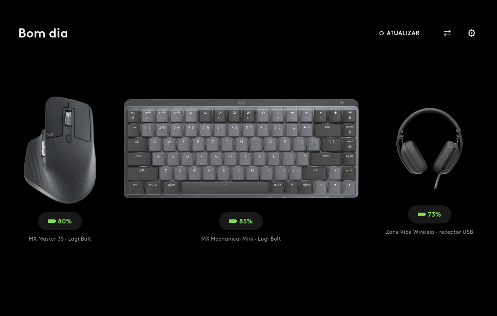
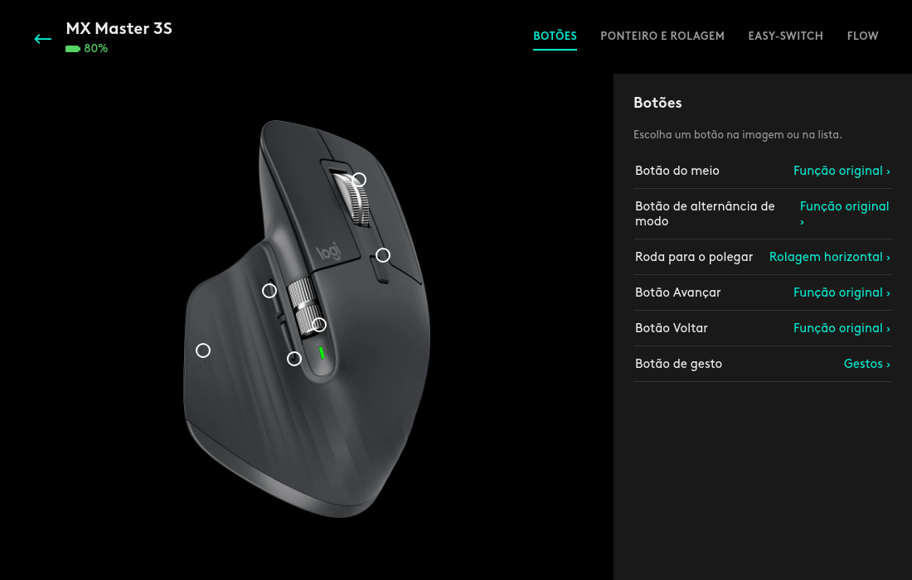
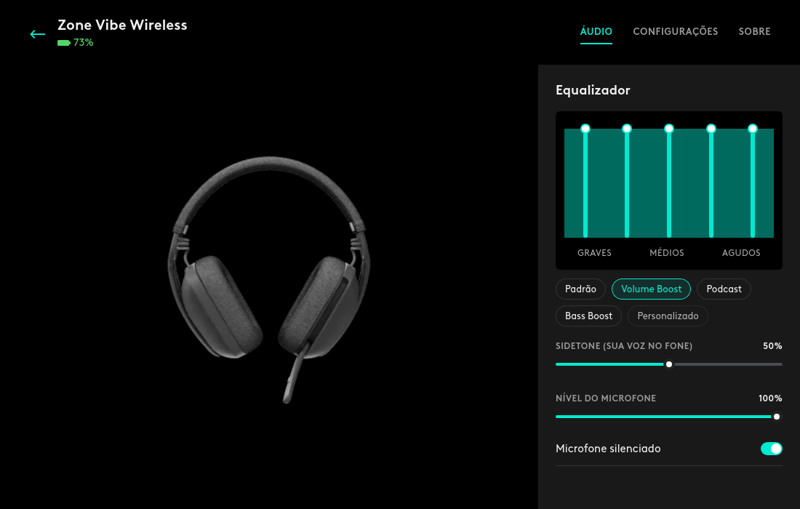
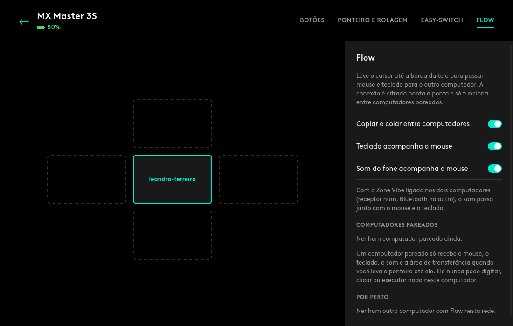
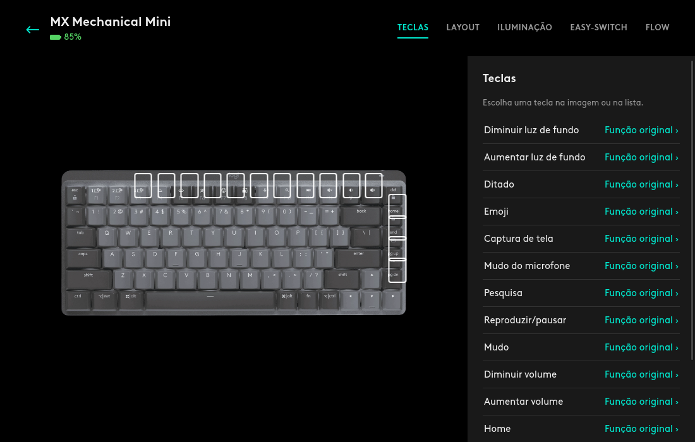
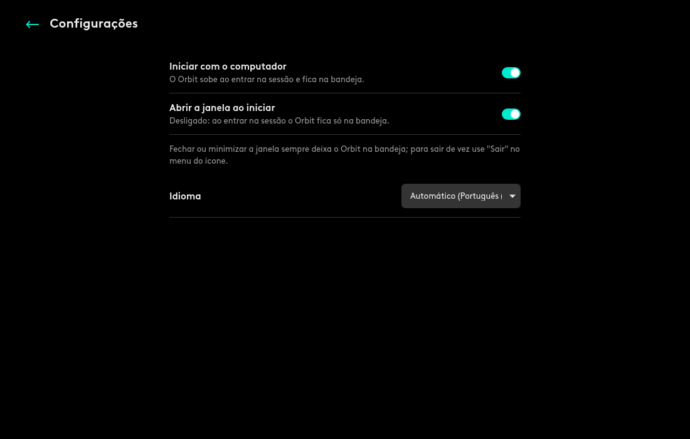
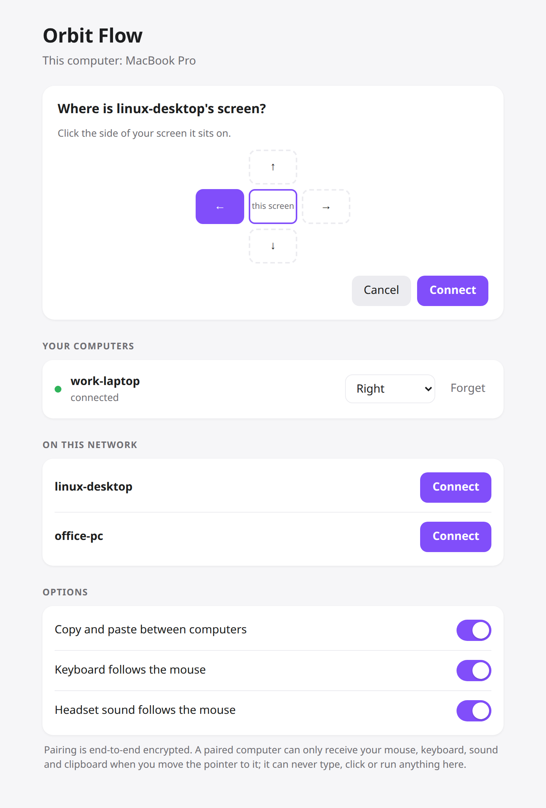

# Orbit

**Your Logitech mouse, keyboard and headset, fully at home on Linux, and moving between your computers as one.**

Orbit replaces Logi Options+ and Logi Tune on Linux, apps Logitech never shipped for it.
It sets everything those apps set, with the same look. And it does one thing they don't:
push the pointer off the edge of the screen and the **mouse, the keyboard and the headset's
sound** go to the next computer together, Linux to Mac or Windows and back.

No vendor app, no cloud, no account. One Rust program talks straight to the devices
(`/dev/hidraw`), and everything works offline. Internally the project is `hidpilot`:
that is the name of the commands, services and repository.

<p align="center">
  
  
</p>
<p align="center">
  
  
</p>
<p align="center">
  
  
</p>

### Why it's worth it

- **Everything in one place.** DPI, SmartShift, wheels, thumb wheel, backlight, F-keys, OS
  layout, Easy-Switch hosts, button actions and gestures for the mice and keyboards; equalizer,
  sidetone, microphone, mute, rotate-to-mute, voice prompts and auto power off for the headset.
- **Flow, with your sound.** Mouse, keyboard and clipboard follow the pointer to the other
  computer. Turn on *audio follows* and the Zone Vibe's sound comes along: the computer you leave
  lets go of the headset and the one you reach takes it. A manual choice of output is never
  overridden.
- **Live.** Switch the headset on, plug the receiver, move it from its USB receiver to Bluetooth:
  the app notices in seconds, with no refresh button.
- **Batteries in GNOME.** The kernel has no driver for the Logi Bolt receiver; Orbit's battery
  service makes the devices show up in GNOME's power menu, with their names and levels, and
  warns at 15%.
- **Safe by design.** The network side never types or clicks anything: it only says where the
  pointer enters. Pairing uses a 6-digit code (SPAKE2), then Noise with pinned keys, on your
  local network only. The system service is sandboxed: no network, read-only system, no
  capabilities.
- **Speaks your language.** The app, the tray and the Flow page follow your system language,
  or pick one in the settings: Português (Brasil), English, Español, Français, Deutsch, Italiano,
  Nederlands, Polski, Čeština, Svenska, Русский, Українська, Türkçe, Bahasa Indonesia, Tiếng Việt,
  हिन्दी, 日本語, 한국어, 简体中文, 繁體中文.

**Status:** MX mice and keyboards work over HID++ 2.0 (Bolt/Unifying receivers and Bluetooth). The Zone Vibe Wireless headset works over Centurion through its USB receiver; over Bluetooth Linux plays the sound and shows the battery. Flow runs on Linux (X11), macOS and Windows.

Tested on: MX Master 3S, MX Mechanical Mini (Logi Bolt receiver), Zone Vibe Wireless (Zone receiver and Bluetooth).

## Install

Pick your system. Each one is a clone and one script; the script shows what it will do,
builds, installs, starts everything at login and checks that it is running.

| System | What you get | How |
|---|---|---|
| **Linux** (Ubuntu 24.04 or similar, GNOME) | The Orbit app, the `hidpilot` CLI, batteries in GNOME, button actions and Flow | [`./install.sh`](#on-linux) |
| **macOS** | Flow: the Mac receives the mouse, keyboard and sound and hands them back | [`./scripts/install-macos.sh`](#on-a-mac-flow) |
| **Windows** | Flow, same role as the Mac | [`scripts\install-windows.ps1`](#on-windows-flow) |

Logitech's own apps keep working on the Mac and on Windows; Orbit only adds Flow there.

### On Linux

You need Ubuntu 24.04 or similar (GNOME, X11 or Wayland for the app; Flow needs X11), and
three minutes.

**1. Install the build tools** (once):

```sh
sudo apt install build-essential pkg-config libwebkit2gtk-4.1-dev libgtk-3-dev \
                 libayatana-appindicator3-1 p7zip-full git curl
curl https://sh.rustup.rs -sSf | sh        # Rust, if you do not have it
```

**2. Get hidpilot and install it:**

```sh
git clone https://github.com/leandrodaf/hidpilot.git
cd hidpilot
./install.sh
```

The installer shows what it will do, asks once to continue and once for your password, and
then does everything: builds, installs the programs and the app, starts the services, sets up
the device rules, opens Flow in the firewall for your local network, downloads Logitech's
device pictures and fonts from Logitech's own installers, and finally checks that each part
is running and that GNOME sees your batteries.

**3. Open "Orbit"** from the app grid. From then on it starts with the computer and lives
in the tray (closing or minimizing the window keeps it there).

Options: `./install.sh --help` (`-y` skips the question; `--no-flow`, `--no-remap`,
`--no-firewall`, `--no-assets` leave parts out). To update, `git pull && ./install.sh`.
To remove everything, `./uninstall.sh` (it asks before deleting your settings).

### Instalação no Linux (pt-BR)

```sh
sudo apt install build-essential pkg-config libwebkit2gtk-4.1-dev libgtk-3-dev libayatana-appindicator3-1 p7zip-full git curl
curl https://sh.rustup.rs -sSf | sh              # Rust, se ainda não tiver
git clone https://github.com/leandrodaf/hidpilot.git && cd hidpilot
./install.sh                                     # pergunta uma vez e pede a senha uma vez
```

Depois abra **Orbit** na grade de aplicativos. Ele inicia junto com o computador e fica na
bandeja; para atualizar, `git pull && ./install.sh`; para remover, `./uninstall.sh`.
No Mac, `./scripts/install-macos.sh`; no Windows, `scripts\install-windows.ps1` (só o Flow,
veja abaixo). O app segue o idioma do sistema; dá para trocar em Configurações.

### On a Mac (Flow)

The Mac is the other end of Flow: it gets `hidpilot-flow`, which receives the mouse, keyboard
and sound and hands them back. macOS needs no driver for the Logi Bolt receiver or the Zone
Vibe, and the Mac can keep Logi Options+ for its own settings.

```sh
xcode-select --install                     # once, if you never installed the command line tools
git clone https://github.com/leandrodaf/hidpilot.git && cd hidpilot
./scripts/install-macos.sh                 # builds, starts at login, opens the Flow page
```

The Flow page opens in the browser: pick the Linux computer under *On this network*, click
where its screen sits, and type the code it shows. No terminal needed after the install:
the script also puts **Orbit Flow** in Launchpad and Spotlight, which opens that page again.
There is no Orbit app on the Mac; its own settings stay in Logi Options+.

The script uses Homebrew for `SwitchAudioSource` (without it, the mouse and keyboard still move
and the sound stays). **If the mouse arrives on the Mac but never comes back**, the Mac could not
talk to it: give `~/.local/bin/hidpilot-flow` *Input Monitoring* in System Settings → Privacy &
Security (the "+" button, then ⌘⇧G to type the path), and check with `hidpilot-flow devices`,
which lists the mice and keyboards the Mac can see and their Easy-Switch channels. To update, `git pull && ./scripts/install-macos.sh`;
to remove, `./scripts/install-macos.sh --uninstall`.

### On Windows (Flow)

Same role as the Mac. Install [Rust](https://rustup.rs) (accept the Visual Studio C++ build
tools it offers), then in PowerShell:

```powershell
git clone https://github.com/leandrodaf/hidpilot.git
cd hidpilot
powershell -ExecutionPolicy Bypass -File scripts\install-windows.ps1
```

Without Rust, download `hidpilot-flow.exe` from the
[latest release](https://github.com/leandrodaf/hidpilot/releases/latest) and pass it with
`-Exe C:\path\hidpilot-flow.exe`. The script installs the `AudioDeviceCmdlets` PowerShell module
(for the sound), starts the agent hidden at login, adds **Orbit Flow** to the Start menu
(it opens the Flow page) and checks it is running; `-Uninstall` removes it all. At the end
the Flow page opens, to pair just like on the Mac.

### What gets installed (Linux)

| What | Where |
|---|---|
| `hidpilot` (CLI), `hidpilot-flow`, `hidpilot-gui` (the app) | `~/.local/bin` |
| App launcher, icon, start at login | `~/.local/share/applications`, `~/.local/share/icons`, `~/.config/autostart` |
| Low battery notifications, Flow, button actions (user services) | `~/.config/systemd/user` |
| Device access rules | `/etc/udev/rules.d/70-hidpilot.rules` |
| Battery service, root, sandboxed: no network, read-only system, no capabilities | `/etc/systemd/system/hidpilot-battery.service` |
| Logitech's pictures and fonts, taken from Logitech's installers on your machine (never shipped with hidpilot) | `~/.local/share/hidpilot/logitech` |

The kernel has no driver for the Logi Bolt receiver, so without hidpilot GNOME does not know
the devices behind it. The battery service is what makes them appear in GNOME's power
settings, with their names and levels.

### Services

```sh
systemctl status hidpilot-battery            # batteries in GNOME (system)
systemctl --user status hidpilot-notify      # low battery warnings at 15%
systemctl --user status hidpilot-flow        # Flow
systemctl --user status hidpilot-remap       # custom button actions
journalctl --user -u hidpilot-flow -f        # follow a service's log
```

The app writes what it does with its window and tray to `~/.local/state/hidpilot/gui.log`.

## Usage

```sh
hidpilot list                                  # connected devices
hidpilot info master                           # firmware, battery, settings, features
hidpilot battery                               # battery of every device
hidpilot dpi master 1600                       # pointer sensitivity
hidpilot smartshift master --mode ratchet --threshold 20
hidpilot wheel master --hires on --invert off
hidpilot thumbwheel master --invert on
hidpilot backlight mechanical --mode off
hidpilot fn-keys mechanical on                 # F1-F12 without holding Fn
hidpilot platform mechanical linux             # key layout (same as Fn+O / Fn+P)
hidpilot host master                           # Easy-Switch hosts
hidpilot host master 2                         # switch to host 2
hidpilot buttons master                        # reprogrammable buttons
```

Devices are picked by list number or by any part of their name.

### Headset

```sh
hidpilot headset                               # battery, equalizer, sidetone, mic...
hidpilot headset --eq podcast                  # a preset (default, volume-boost, podcast, bass-boost)
hidpilot headset --eq 40,20,0,-20,30           # or five bands, -128..127 (0 = flat)
hidpilot headset --sidetone 5                  # hear your own voice, 0-10
hidpilot headset --mute on
hidpilot headset --voice-prompts off
hidpilot headset --rotate-to-mute on           # flip the boom up to mute
hidpilot headset --auto-sleep 30               # minutes before it powers off
hidpilot headset --name "Zone Vibe Wireless"
```

## Flow

Push the pointer against the screen edge facing another computer and the mouse and keyboard switch to it, with the clipboard. Both computers run `hidpilot-flow` (Linux, Windows and macOS builds are attached to each [release](https://github.com/leandrodaf/hidpilot/releases)) and the devices must be paired with both (Easy-Switch channels).

**Pairing works like Bluetooth.** On either computer open the Flow page (in Orbit: Flow; on a
Mac or Windows PC it opens after the install, or with `hidpilot-flow ui`). Computers running
Flow on the same network show up by themselves. Click one, say where its screen sits, and that
computer shows a 6-digit code, in a notification and on its Flow page; type it and both are
paired, each knowing where the other's screen is. If the other computer does not show up
(Wi-Fi that isolates clients, guest networks, mesh systems and some routers drop the mDNS
announcement), each Flow page shows this computer's IP address: type the other one's under
*Not listed?* and pair the same way. Once paired, the computers reconnect by address too.

<p align="center"></p>

**Audio follows** (on by default; in the app: Flow → *Headset sound follows the mouse*). The
Zone Vibe stays linked to both computers at once, its USB receiver on one and Bluetooth on the
other, and plays the one that sends sound. When the mouse leaves, this computer lets go of the
headset and goes back to the output it used before, as if the headset were not there; the
computer receiving the mouse makes the headset its output (Linux, macOS with
`SwitchAudioSource`, Windows with `AudioDeviceCmdlets`). On Linux the same switch also keeps the
output following the headset by itself: switch it on and it becomes the output, switch it off
and the previous one comes back, and when it is linked to both the receiver and Bluetooth of
the same computer the receiver wins. Only those moments change the output: one you picked by
hand is never overridden.

```sh
hidpilot-flow ui                               # the Flow page (pairing, positions, options)
hidpilot-flow pair --to "other-pc"             # or from the terminal: type the code it shows
hidpilot-flow place "other-pc" right           # where its screen is
hidpilot-flow peers                            # paired computers
hidpilot-flow set --clipboard false            # keep the clipboard to yourself
hidpilot-flow set --audio-follows false        # the sound stays where it is
```


### Security

Flow moves devices, not control. A paired computer can only say "the pointer enters at this
edge", hand over the clipboard together with the mouse (never on its own) and ask for the
headset's sound; nothing is ever typed, clicked or run over the network.

- **Pairing:** the code is shown only on the computer being asked, never sent. It keys SPAKE2
  and then Noise XXpsk3, so each request is a single guess at a 6-digit code (one in a million),
  with at most six requests per ten minutes and one at a time. The notification says to type
  it only on a computer of your own.
- **After pairing:** Noise IK with keys pinned at pairing time; connections from anything else
  are dropped before they can send a message.
- **Network:** TCP 47811 (links) and 47812 (pairing requests) plus mDNS, on the local network;
  the installer opens them in UFW for your subnet only. Discovery announces just a name and a
  public key.
- **The Flow page** listens on 127.0.0.1:47813 only. Every call needs a token stored in a file
  only your user can read, and the Host header must be the loopback address, so web pages in
  the browser cannot call it (no CORS, DNS rebinding refused).
## Button remapping and gestures

`hidpilot remap run` is a user service that gives buttons, the gesture button, the thumb
wheel and keyboard special keys new actions, like Logi Options+. Without configuration the
gesture button gets the Options+ gestures: click or swipe up for the activities overview,
down for the desktop, left/right to change workspace.

```sh
hidpilot remap buttons master                  # buttons that take an action
hidpilot remap actions                         # what they can do
hidpilot remap set master back key:alt+left
hidpilot remap set master forward tab-next --app firefox    # only while Firefox has focus
hidpilot remap set mechanical emoji cmd:gnome-characters
hidpilot remap thumbwheel master volume
hidpilot remap run
```

Settings live in `~/.config/hidpilot/buttons.toml` and are reloaded while the service runs.
Only buttons with an action in the profile of the focused app are diverted; the rest keep
their normal behaviour, and stopping the service gives every button back.

## Supported HID++ features

| Feature | ID | Commands |
|---|---|---|
| Firmware info | 0x0003 | `info` |
| Unified battery | 0x1004 | `battery`, `info` |
| Change host / hosts info | 0x1814 / 0x1815 | `host`, Flow |
| Backlight | 0x1982 | `backlight` |
| Reprogrammable controls v4 | 0x1b04 | `buttons` |
| SmartShift (and enhanced) | 0x2110 / 0x2111 | `smartshift` |
| High resolution wheel | 0x2121 | `wheel` |
| Thumb wheel | 0x2150 | `thumbwheel` |
| Adjustable DPI | 0x2201 | `dpi` |
| Fn inversion | 0x40a3 | `fn-keys` |
| Multi-platform | 0x4531 | `platform` |

The headset protocol is documented in [docs/zone-vibe-protocol.md](docs/zone-vibe-protocol.md).

## Roadmap

- Audio follows on Windows
- Headset settings over Bluetooth (today they need the USB receiver)
- Flow with computers running Logi Options+ ([docs/flow-interop.md](docs/flow-interop.md))
- Device-specific icons in GNOME (UPower files every `/dev/uhid` battery as a generic battery)

## Credits

Protocol knowledge comes from Logitech's public HID++ 2.0 documents and from studying [Solaar](https://github.com/pwr-Solaar/Solaar) and [HeadsetControl](https://github.com/Sapd/HeadsetControl). No code was copied from them.

Not affiliated with Logitech. Logitech, MX and Zone are trademarks of Logitech.
